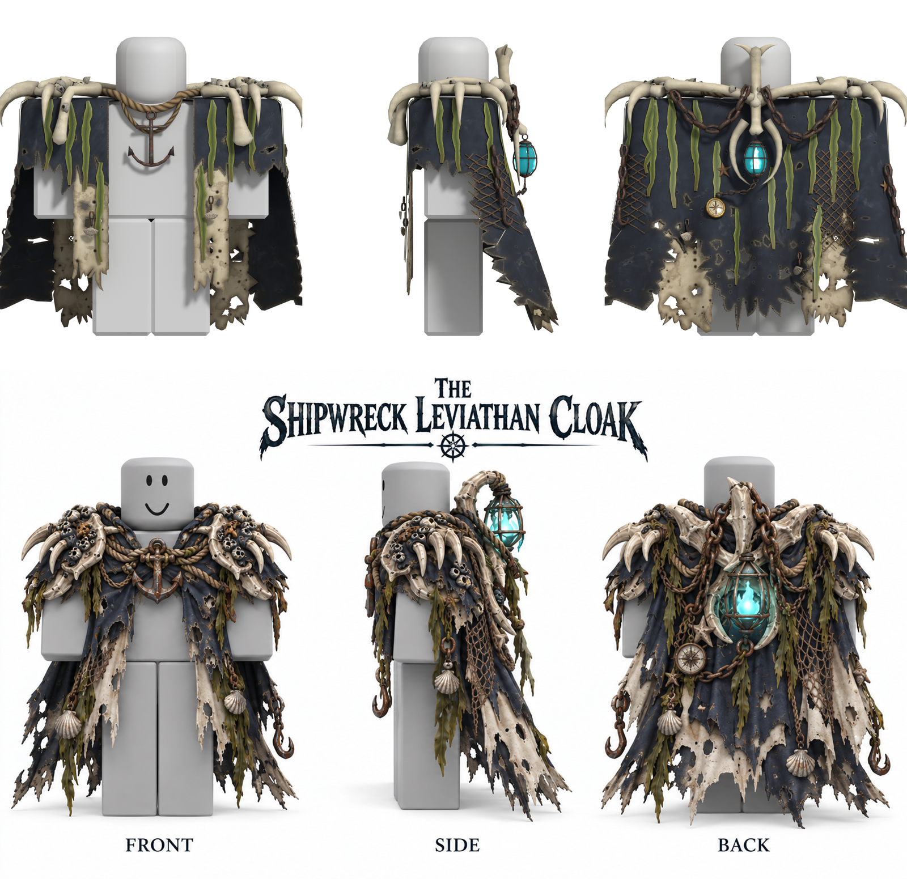

# Shipwreck Leviathan Cloak — 3D-плащ для Roblox (R6)

Плащ сделан по референсу «The Shipwreck Leviathan Cloak» и подогнан под присланный манекен R6
(`R6 character Maneken.obj`). Это один скиннутый меш с костями для вашей собственной физики.



## Что внутри `output/`

| Файл | Назначение |
|---|---|
| `ShipwreckLeviathanCloak.fbx` | **основной файл для Roblox Studio**: меш, кости, веса, встроенные текстуры |
| `ShipwreckLeviathanCloak.glb` | тот же плащ в glTF (просмотр и альтернативный импорт) |
| `ShipwreckLeviathanCloak.blend` | исходник Blender 4.5 вместе с манекеном R6 для проверки посадки |
| `Textures/…_TextureID_2048.png` | цветная текстура 2048×2048 (AO запечён, фонарь «светится») для `MeshPart.TextureID` |
| `Textures/…_ColorMap_1024.png` и `NormalMap`, `RoughnessMap`, `MetalnessMap`, `EmissiveMask` (все `_1024`) | PBR-набор для `SurfaceAppearance` (лимит Roblox 1024×1024) |
| `Textures/…_ColorMap_2048.png`, `…_NormalMap_2048.png` | версии 2048 для рендеров и других движков |
| `Previews/` | рендеры спереди, сбоку, сзади, в 3/4 и тест деформации костями |
| `build_report.json` | технический отчёт: полигоны, кости, проверки |

## Характеристики

- **Треугольников: 19 033** (лимит Roblox на MeshPart 20 000), вершин около 13 тыс.
- Один меш, один материал, один UV-атлас.
- Масштаб: 1 юнит = 1 stud, точка (0,0,0) совпадает с центром Torso манекена.
- Ткань сделана с толщиной (замкнутая оболочка, 2 см), поэтому `DoubleSided` включать не нужно.
- **60 костей**, у каждой вершины не больше 4 влияний, веса нормализованы, у `Root` весов нет.
- Пересечений с телом R6 и между декором и тканью нет: это проверяется автоматически при сборке.

Элементы: тёмно-синий рваный плащ с кремовыми слоями, дырами и солевыми пятнами; костяные наплечники
(по 4 когтя, 4 черепа, кость-челюсть, ребро и баланусы на каждом плече); верёвочный воротник и
якорь на груди; на спине костяной гребень с рогами, светящийся фонарь в костяном полумесяце, компас
на цепи и морские звёзды; два ржавых крюка на цепях, 4 ракушки, 26 прядей водорослей и 2 куска сети.

## Импорт в Roblox Studio

1. **File → Import 3D** и выберите `ShipwreckLeviathanCloak.fbx`.
2. Настройки (по документации Roblox для экспорта из Blender):
   - **Scale Unit = Studs** (по умолчанию);
   - **World Forward = Front**, **World Up = Top** (по умолчанию);
   - **Rig Type = Custom**, если импортёр не выбрал его сам (не R15 и не No Rig, иначе пропадут кости).
3. Получится модель с MeshPart `ShipwreckLeviathanCloak`, кости `Bone` лежат внутри неё.
4. Текстуры. Если встроенная текстура не подхватилась:
   - простой вариант: загрузите `…_TextureID_2048.png` в `MeshPart.TextureID`;
   - PBR-вариант: добавьте в MeshPart `SurfaceAppearance` и укажите `ColorMap`, `NormalMap`,
     `RoughnessMap`, `MetalnessMap` (файлы `_1024`). Для свечения фонаря задайте
     `EmissiveMaskContent` = `…_EmissiveMask_1024.png`, `EmissiveStrength` около 2–4 и голубой `EmissiveTint`.
     Для заметного свечения в игре можно ещё добавить `PointLight` к кости `Lantern`.

## Посадка на персонажа R6

Начало координат модели совпадает с центром `Torso`, кость `Root` стоит ровно там же.

- Импортёр по умолчанию ставит pivot модели в начало сцены (**Set Pivot to Scene Origin**), поэтому
  обычно хватает выровнять pivot по `Torso` (например, `PivotTo(Torso.CFrame)`).
- Если pivot сместился, центр MeshPart относительно центра Torso равен
  **(X, Y, Z) = (0.027, −0.485, 0.335) studs** (в осях Torso: X вправо, Y вверх, Z назад), то есть
  `MeshPart.CFrame = Torso.CFrame * CFrame.new(0.027, -0.485, 0.335)`.
  Размер MeshPart: 5.33 × 4.93 × 2.93 studs.
- Затем приварите MeshPart к Torso (`WeldConstraint`) и выставьте `Anchored = false`,
  `CanCollide = false`, `CanTouch = false`, `CanQuery = false`, `Massless = true`.

## Кости для физики

```
Root                       центр Torso, весов нет
└─ CloakBase               жёсткая часть: наплечники, воротник, гребень, полумесяц
   ├─ Cape_L4_1 … Cape_L4_5 → Cape_L4_Tip   перед слева (передняя полоса и капюшон над рукой)
   ├─ Cape_L3_1 … _5 → _Tip                 левый бок над рукой
   ├─ Cape_L2_1 … _5 → _Tip                 левый задний угол
   ├─ Cape_L1_1 … _5 → _Tip                 спина слева
   ├─ Cape_C_1  … _5 → _Tip                 центр спины
   ├─ Cape_R1 / R2 / R3 / R4 …              зеркально справа
   ├─ Lantern → Lantern_Tip                 фонарь (маятник)
   └─ Anchor  → Anchor_Tip                  якорь на груди (маятник)
```

- `L`/`R` — левая и правая сторона **персонажа**. Цепочки идут по кругу: перед слева → левый бок →
  спина → правый бок → перед справа.
- Регулярная сетка **9 цепочек × 5 костей**: суставы с одинаковым номером стоят на одной высоте
  по ткани (шаг около 0.8 stud). Поэтому соседние цепочки удобно связывать по рядам (`_k` с `_k`),
  получится ткань, а не отдельные «верёвки».
- `_1` крепится у края плеча, `_5` самая нижняя. `_Tip` — конечная точка без весов, по ней удобно
  считать направление последнего сегмента.
- Оси костей в файле: **+Y** идёт вниз по цепочке к следующему суставу, **+Z** смотрит наружу от тела.
  Поворот вокруг локальной X раскачивает плащ наружу и внутрь, вокруг Z — вбок.
- Веса плавные: ткань смешивается между двумя соседними цепочками и двумя соседними костями, а
  верх на плечах на 100 % принадлежит `CloakBase`. Крюки, ракушки, компас, звёзды, цепи, водоросли
  и сеть привязаны к весам ткани и двигаются вместе с ней. Цепочка компаса плавно переходит от
  кости `Lantern` к ткани.
- `Root` и `CloakBase` двигаются вместе с Torso, симулировать нужно `Cape_*`, `Lantern` и `Anchor`.

## Что проверено

- Повторный импорт FBX и GLB в чистую сцену Blender: 19 033 треугольника, один UV-канал,
  60 костей, корень `Root` в (0,0,0), ≤4 влияния, суммы весов равны 1, невзвешенных вершин нет.
- Тест деформации: все цепочки поворачивались вместе («ветер») и по отдельности. Разрывов и
  NaN нет, вершины не «взрываются». Рендеры в `Previews/pose_test_*.png`.
- Автоматическая проверка, что ни одна вершина не заходит в тело R6 и декор не проваливается в ткань.
- **Не проверено:** импорт в сам Roblox Studio здесь недоступен. Оси, масштаб и настройки
  импортёра выставлены по официальной документации Roblox для Blender.

## Пересборка (по желанию)

Всё генерируется скриптами в `scripts/` (Blender 4.5 LTS, без ручной работы):

```bash
bash scripts/setup_blender.sh   # Blender 4.5 + shapely/triangle/scipy/pillow
/tmp/blender/blender-4.5.16-linux-x64/blender -b --factory-startup -P scripts/build.py -- --size 2048
/tmp/blender/blender-4.5.16-linux-x64/blender -b --factory-startup -P scripts/verify_fbx.py -- output/ShipwreckLeviathanCloak.fbx
```

Основные модули: `cloak/drape.py` (форма драпировки), `cloak/cloth.py` (рваные выкройки и толщина
ткани), `cloak/parts.py` и `cloak/layout.py` (декор), `cloak/materials.py` и `cloak/bake.py`
(процедурные материалы и запекание), `cloak/rig.py` (кости и веса).

## Замечания

- Текстуры процедурные, запечены в Cycles. Детализация упрощена так, чтобы уложиться в 20 000 треугольников.
- В референсе фонарь на виде сбоку висит над плечом, а на виде сзади — по центру спины. Сделан вариант
  с вида сзади: так фонарь не перекрывает голову спереди.
